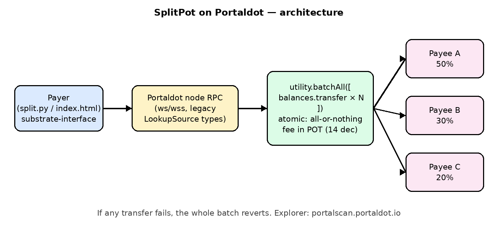
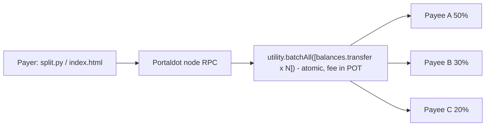

# SplitPot on Portaldot

Atomic payment splitter for the Portaldot Network (Ecosystem DApps track, Portaldot Hacker House 2026). A port of [SplitEscrow on Arc](https://github.com/jackzhu88/splitescrow-arc).

One payer sends a total amount, and it is split by percentage shares across N payees in a single `utility.batchAll` extrinsic. If any transfer fails, the whole batch reverts. It uses native Portaldot pallets (`balances`, `utility`), and fees are paid in POT (14 decimals).

## Run
```bash
wget https://github.com/portaldotVolunteer/Portaldot-node/raw/main/portaldot-testnet-ubuntu.tar.gz
tar xzf portaldot-testnet-ubuntu.tar.gz && cd portaldot-testnet-ubuntu
./portaldot_dev --dev --alice --rpc-cors all
pip install substrate-interface
python split.py     # creates a throwaway key, funds it from //Alice, then splits 10 POT 50/30/20
```
The results of a real run are in `testnet_run.json`, and there is a demo page in `index.html`. Note: the node uses the legacy `LookupSource` type, so connect with `type_registry_preset="substrate-node-template"`.

Author: jackzhu88

## Architecture




## Network / deployment status
- Portaldot exposes a public **mainnet** RPC (`wss://mainnet.portaldot.io`, chain "Portaldot Mainnet", SS58 42, POT 14 decimals) and the explorer `portalscan.portaldot.io`.
- The official docs list no public testnet RPC and no faucet. The documented "testnet" is the local dev node (`portaldot_dev --dev`) shipped in `portaldot-testnet-ubuntu.tar.gz`.
- `testnet_run.json` is a real run on that official dev/testnet node: the fund tx is `0x7ed46672…3047`, and the atomic split tx is `0x07aa9f22…424b`, in block `0x138479a4…53b3`.
- `split.py` already accepts `RPC=wss://…`, so the same script runs unchanged against any public Portaldot endpoint once a funded account is available.

## Progress report (check-in)
**Done**
- Atomic N-way percentage splitter using native pallets (`utility.batchAll` + `balances.transfer`).
- Python CLI (`split.py`), demo script (`demo.sh`), and a static demo page (`index.html`).
- End-to-end run on the official Portaldot dev/testnet node, with tx hashes in `testnet_run.json`.
- Demo video (`splitpot_demo.mp4`), pitch deck (`splitpot_deck.pdf`), and architecture diagram.

**Outstanding (before Nov 6 code freeze)**
- A run on a public Portaldot network with explorer links. This is blocked on obtaining POT: there is no public faucet.
- A browser UI that signs with a wallet extension (polkadot.js) instead of a CLI key.
- Input validation and rounding-dust handling, shares that don't sum to 100, and fee estimation display.
- Optional: an ink!/EVM contract version with reusable split groups.
