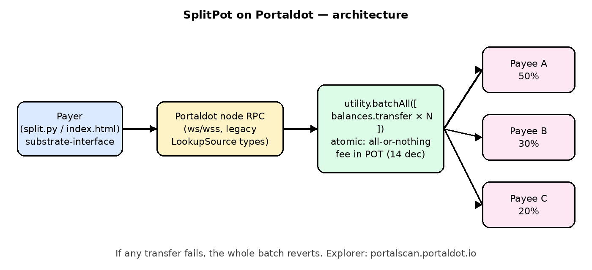
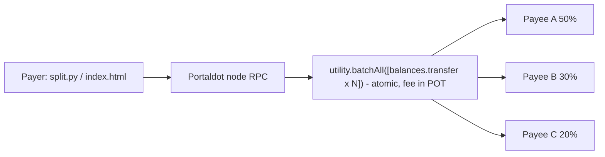

# SplitPot on Portaldot

Atomic payment splitter for the Portaldot Network (Ecosystem DApps track, Portaldot Hacker House 2026). A port of [SplitEscrow on Arc](https://github.com/jackzhu88/splitescrow-arc).

One payer sends a total amount, and it is split by percentage shares across N payees in a single `utility.batchAll` extrinsic. If any transfer fails, the whole batch reverts. It uses native Portaldot pallets (`balances`, `utility`), and fees are paid in POT (14 decimals).

## For judges: 2-minute check
- **Proof on a public network:** [extrinsic `182786-1`](https://scanner-testnet-v3.portaldot.dev/extrinsics/182786-1) on PortaldotV3 testnet: one `utility.batchAll`, 3 transfers (3 / 1.8 / 1.2 tPOT), fee **0.02360775504659 tPOT**. Raw record: [`testnet_run.json`](testnet_run.json).
- **Why it matters:** group payouts (bounties, shared bills, revenue shares) in one atomic transaction. No partial payouts, one fee, and no custom contract needed.
- **Try it without a key:** `DRY_RUN=1 python split.py 6` prints the planned amounts and a live fee estimate from the testnet, without signing anything.
- **Demo:** `index.html` (proof + split calculator), `splitpot_demo.mp4`, `splitpot_deck.pdf`.

## Run
```bash
pip install substrate-interface
# payer key: a JSON file with a "mnemonic" field, kept outside the repo
KEY_FILE=/path/to/key.json python split.py 6 testnet_run.json   # split 6 tPOT 50/30/20 on the public V3 testnet
```
`split.py` targets the public PortaldotV3 testnet by default (`RPC=wss://test-node-v3.portaldot.dev`); set `RPC=` to point it at another Portaldot node. It records the fee from the `TransactionPayment.TransactionFeePaid` event and only reports success on `System.ExtrinsicSuccess`. There is a demo page in `index.html`.

```bash
DRY_RUN=1 python split.py 6                  # validate + preview amounts + fee estimate, no key, nothing sent
SHARES=60,40 DRY_RUN=1 python split.py 2.5   # custom shares (positive integers summing to 100)
python -m unittest test_splitmath            # split math tests (no network needed)
```
Inputs are checked before anything touches the network: shares must be positive integers summing to 100, and amounts are converted to planck with exact decimal math (no float rounding). Any rounding dust goes to the last payee, so the payees always receive exactly the total.

## Public testnet run (PortaldotV3)
A real split on the public PortaldotV3 testnet (spec 3002), signed by our own test account with test tokens (tPOT) only. Full record: [`testnet_run.json`](testnet_run.json).

| Field | Value |
|---|---|
| Extrinsic | [`0xc13806ef8b6dfd916c33c64c60028e063946f74d0f7e6313d747f897e1b83d88`](https://scanner-testnet-v3.portaldot.dev/extrinsics/182786-1) (`182786-1`) |
| Block | [#182786](https://scanner-testnet-v3.portaldot.dev/blocks/182786), `0x4dbd14ed…6481f`, finalized |
| Time (UTC) | 2026-10-25T02:12:12Z |
| Call | `utility.batchAll([balances.transferKeepAlive x 3])` |
| Split | 6 tPOT, 50/30/20 → 3 / 1.8 / 1.2 tPOT |
| Fee charged | **0.02360775504659 tPOT** (2,360,775,504,659 planck, from the `TransactionFeePaid` event) |
| Payer | `5CoM2exPBkAfHQbG2pivUVHQQ9GL6CddpfU7pwwkUximziXx`: 500 → 493.97639224495341 tPOT (6 split + fee) |

The payees are the project's fixed demo accounts (`//SplitPayee0..2`), each new on this network: `5CFYPSHT…cYDJ` received 3 tPOT, `5Ckhfy5n…VLm1` received 1.8 tPOT, `5CZh3cfC…1A3B` received 1.2 tPOT.

> **Mainnet ban:** `//SplitPayee0..2` are public Substrate development URIs. They are fine for tPOT self-tests on testnet only. **Never use them (or any other public Substrate //dev URI) as payees or signers on mainnet.** See [`COMPLIANCE.md`](COMPLIANCE.md).

Earlier, before public testnet tokens were available, the same flow ran on the official local dev node (`portaldot_dev --dev`): split tx `0x07aa9f22…424b`. That was not a public network.

Author: jackzhu88

## Architecture




## Network / deployment status
- **Public testnet:** PortaldotV3 Test, RPC `wss://test-node-v3.portaldot.dev`, explorer [scanner-testnet-v3.portaldot.dev](https://scanner-testnet-v3.portaldot.dev), token tPOT (14 decimals, SS58 42). SplitPot has run there; see above.
- **Mainnet:** `wss://mainnet.portaldot.io`, explorer `portalscan.portaldot.io`. Not used. Mainnet must never use `//SplitPayee0..2` public Substrate development URIs (see COMPLIANCE.md).

## Progress report (check-in)
**Done**
- Atomic N-way percentage splitter using native pallets (`utility.batchAll` + `balances.transfer`).
- Python CLI (`split.py`), demo script (`demo.sh`), and a static demo page (`index.html`).
- End-to-end run on the public PortaldotV3 testnet, with the extrinsic hash, explorer link and fee in `testnet_run.json` (earlier also on the local dev node).
- Demo video (`splitpot_demo.mp4`, includes public V3 explorer proof), pitch deck (`splitpot_deck.pdf`), and architecture diagram.
- Input validation (shares sum to 100, exact decimal amounts), `DRY_RUN` fee estimate, and unit tests for the split math.
- Demo page with a 2-minute proof checklist and a split calculator.

**Outstanding (before Nov 6 code freeze)**
- A browser UI that signs with a wallet extension (polkadot.js) instead of a CLI key.
- Optional: an ink!/EVM contract version with reusable split groups.
